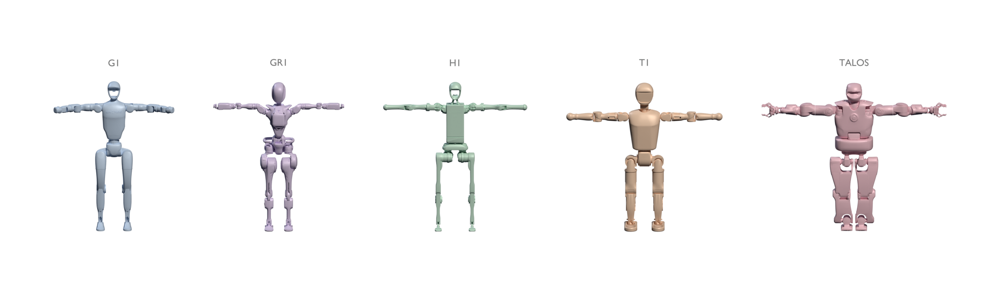
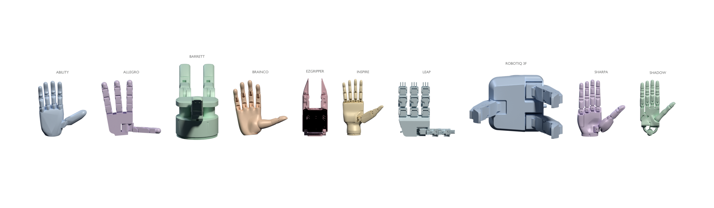

# Render model teasers

`scripts/render_teaser.py` follows the
[Body Models teaser](https://github.com/abcamiletto/body-models/blob/main/scripts/render_teaser.py):
load actual meshes through the NumPy API and render labeled pastel lineups with
headless Blender/Cycles. It produces separate humanoid and hand PNGs.





From a robot-models checkout:

```bash
uv run --script scripts/render_teaser.py
```

The script declares its own Python 3.13 and Blender dependencies using PEP 723.
`uv` provisions that isolated environment; Blender is not added to the library's
runtime or development dependencies. The local library is installed editable so
renders use the current checkout. Published assets download on first use,
following normal `robot-models` configuration and cache conventions.

The default output is `results/teasers/humanoids.png` and `results/teasers/hands.png`:

- Humanoids: G1, GR1, H1, T1 and TALOS in their T-pose presets.
- Hands: right Ability, Allegro, BrainCo, Inspire, LEAP, Sharpa and Shadow in their
  flat presets. Each palm faces the camera with fingers pointing upward.

Meshes are rotated and scaled for display, with equal heights within each lineup.
The images are **not a comparison of physical size**. Shadow's long forearm mesh
is omitted in hand teasers so the palm and fingers remain readable. Model assets,
poses and runtime defaults are unchanged. A proper rotation converts Y-up model
coordinates to Blender Z-up while preserving triangle winding.

## Rendering options

```bash
# Fast draft, using an NVIDIA GPU with Cycles OptiX.
uv run --script scripts/render_teaser.py --device gpu --samples 16 --width 1600 --height 500

# High-quality transparent images and editable Blender scene files.
uv run --script scripts/render_teaser.py --device gpu --samples 256 --save-blend

# Render one lineup, or choose a subset.
uv run --script scripts/render_teaser.py --group humanoids
uv run --script scripts/render_teaser.py --group hands --models allegro shadow

# Regenerate the images committed in the README and documentation.
uv run --script scripts/render_teaser.py --output-dir docs/assets/teasers
```

CPU rendering is the default and uses eight threads; change this with `--threads`.
`--device gpu` requires an OptiX-capable NVIDIA GPU and fails clearly if none is
available. All exports are RGBA PNGs with transparent backgrounds. Neutral gray
labels work on both light and dark pages. The output directory, width, height and
sample count are configurable. Camera framing includes all meshes and labels.

`--save-blend` writes `humanoids.blend` and/or `hands.blend` alongside the PNGs,
including the model meshes, materials, lights, camera and render configuration.
Generated PNGs and scenes stay in the ignored `results/` directory by default.

## Additional hands

The three new canonical hands use the same renderer and model API:

```bash
uv run --script scripts/render_teaser.py --group hands \
  --models barrett robotiq-3finger ezgripper
```

Assets come from the [canonical upstream descriptions](hand-sources.md). The
renderer does not substitute or silently omit models. Images have transparent
backgrounds; upstream asset terms apply to redistributed images and scenes.
